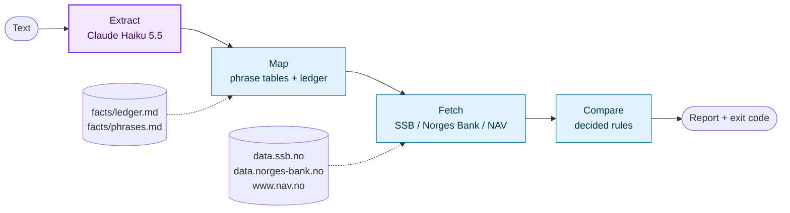

# NorFigures

[](https://github.com/HaakonMedtoaer/NorFigures/actions/workflows/tests.yml)

*Kort på norsk: NorFigures leser en tekst og finner tall om inflasjon, styringsrente, eurokurs og arbeidsledighet, henter de offisielle tallene fra SSB, Norges Bank og NAV, og sier fra når tallet i teksten ikke stemmer.*

**People and AI models both put confident, wrong numbers in documents.** NorFigures
checks the economic figures in a Norwegian text against the official sources and
tells you which ones are wrong, which are right, and which it could not check.



*One indicator per worker. The run is real (the worked example below, replayed
from recorded responses); only the timing is staged. Made from the run log by
`python -m norfigures.animation`.*

```text
$ python -m norfigures check examples/memo.txt --published 2026-11-15 --offline

#  Claim                                   Stated  Official  Verdict                                 Source
-  --------------------------------------  ------  --------  --------------------------------------  ----------------------------------------------------
1  Inflasjonen var 3,1 % i oktober         3.1     3.6       MISMATCHED                              SSB, kpi_12m, 2026-10, table 14706
2  Norges Bank holdt styringsrenten på 4…  4.0     4.5       MISMATCHED                              Norges Bank, policy_rate, 2026-11-13, IR/B.KPRA.SD.R
3  analytikerne venter at kronen svekkes…  12.00   n/a       CANNOT VERIFY (forecast not checkable)  none

Notes:
1. [measure_from_rules, ambiguous_measure] Measure set to '12_month_change' by the mapping rules
   (D12); the extractor said 'level'. Headline CPI, 12-month change, 2026-10: 3.6 (does not match).
   CPI-ATE (core), 12-month change, 2026-10: 2.7 (does not match).
2. [period_inferred] no observation on 2026-11-15; using the latest one before it, 2026-11-13.
3. [forecast_not_checkable] Forecast or expectation; published data cannot confirm it.

Claims found: 3 | matched: 0 | mismatched: 2 | could not verify: 1
Extractor: claude-haiku-5-5 (replayed), 8290 in / 904 out tokens, about $0.0013
(offline: official values replayed from recorded API responses)
```

Exit code 1: at least one figure is wrong. The official values above are real
SSB and Norges Bank data; the memo's numbers are not.

## The one rule

**The AI interprets, the source verifies.** A language model reads the text and
says what each sentence claims. It never supplies a number. Every official
value comes from an SSB, Norges Bank or NAV response fetched in the same run,
and code refuses to report one that didn't.

## Quick start

The core needs Python 3.10+ and no other packages. This runs the example above
offline, from recorded responses, with no API key, in any shell:

```bash
git clone https://github.com/HaakonMedtoaer/NorFigures.git
cd NorFigures
pip install -e .
python -m norfigures check examples/memo.txt --published 2026-11-15 --offline
```

`pip install -e .` installs only NorFigures itself. To skip it, run the last
line with `src` on the path instead (`PYTHONPATH=src` in bash,
`$env:PYTHONPATH = "src"` in PowerShell).

Or skip the install entirely: [replay the example run in your browser](https://haakonmedtoaer.github.io/NorFigures/flowmap.html).

To check your own text, install the AI step and set an
[Anthropic API key](https://platform.claude.com/):

```bash
pip install -e ".[agents]"
export ANTHROPIC_API_KEY=...
norfigures check my-text.txt --published 2026-11-15
```

Other commands: `norfigures latest` prints the newest official value of every
series; `norfigures check --claims FILE` checks hand-written claims with no
model at all; `--format json` gives machine-readable output.

| Exit code | Meaning |
|---|---|
| 0 | Every claim matched |
| 1 | At least one mismatch |
| 2 | No mismatch, but something could not be verified (or nothing was checked) |
| 3 | Bad input, bad config, failed extraction, or a source was unreachable |

## How it works



Only the **purple** box uses a model. Everything blue is plain, deterministic code.

1. **Extract.** Claude Haiku 5.5 lists every claim about a figure: the exact
   words, the number as written, the period and the measure. Code then checks
   that each claim is a verbatim part of the text and that each number appears
   in it, so the model can neither invent a sentence nor change a figure.
2. **Map.** Phrase tables ([`facts/phrases.md`](facts/phrases.md)) recognise
   hedges ("rundt"), forecasts ("venter"), measures ("siste tolv måneder") and
   indicators. Code picks the series from the [ledger](facts/ledger.md). Where
   the tables and the model disagree, the tables win, and the report says so.
3. **Fetch.** The only network code allows three hosts and only GET requests.
4. **Compare.** Rounding, hedges, ranges and ambiguity follow the rules in
   [`docs/decisions.md`](docs/decisions.md). When "inflasjonen" could mean
   headline or core inflation, both figures are shown with what each measures.
5. **Report.** A table for people, JSON for pipelines, and an exit code for CI.
   The count line must add up, and nothing is dropped quietly.

### Flow map

Every run writes one JSON line per step to `runs/<run_id>.jsonl`. The flow map
([`docs/flowmap.html`](docs/flowmap.html)) reads that log and nothing else:
one static page, no framework, no build step. Each claim moves from box to box,
the active box lights up, verdicts end in their colour, and guardrail hits
(a blocked host, a schema failure, a number with no fetch behind it) show in
red. Click a box to see what went in and came out for a claim, including the
exact query.

```bash
norfigures check examples/memo.txt --published 2026-11-15 --offline --flow   # follow a run live
norfigures flow docs/example-run.jsonl                                # replay a saved run
```

Both serve the page on 127.0.0.1 only; the page never controls the pipeline.
The saved run is also [online](https://haakonmedtoaer.github.io/NorFigures/flowmap.html),
as a static page on GitHub Pages.

## What Claude wrote and what I decided

Claude Code wrote the code. I wrote the spec and made the calls; each one is in
[`docs/decisions.md`](docs/decisions.md) with its reason.

- **The one rule** (D1). The model interprets; it never supplies a number.
- **Exit codes** (D3). "Nothing checked" exits 2, because a silent pass is the worst failure.
- **Ambiguity** (D4, D5). When a figure has two valid readings, show both and
  explain each. Matched if either fits, so CI fails on real errors, not wording.
- **Eleven edge-case rules** (D6 to D16): rounding half-up, hedges, forecasts,
  percent vs percentage points, monthly vs 12-month, missing periods, and more.
- **Annual figures** (D21). A year is checked against the annual figure and
  the December rate; matched if either fits.
- **Scraping NAV** (D20). NAV has no API, so its files are read from its
  statistics page, with every expected shape checked and a weekly live check.
- **Phrase tables over model judgement** (D19). If we know what people write,
  a lookup does the job, and every override is visible.
- **A small model** (D17). Claude Haiku 5.5 handles extraction; measured at
  about $0.0014 per text on average over the 35 recorded test texts.
- **Two layers** (D18). The core is standard library only and runs offline;
  the AI step is an optional install.
- **What was cut.** GDP and wages wait; unemployment (AKU, then NAV) was added after the MVP (D16, B41 to B43, D20).
  The planned mapper agent became plain code (B18).

## Guardrails

| Guardrail | Enforced by |
|---|---|
| Three data hosts, GET only | `net.py`; tests try redirects, look-alike hosts and other methods. `www.nav.no` only under its statistics and download paths (D20) |
| Source shape | NAV's page and file are scraped; every expected shape is checked, and a weekly live check (`live-sources` workflow) runs all sources against the real sites |
| Number provenance | Every official value must equal observations fetched in this run, or exit 3 |
| Verbatim extraction | Claims and numbers must appear in the input text, or exit 3 |
| No silent repairs | Invalid claims fail loudly, with every problem listed |
| Loud accounting | Found = matched + mismatched + unverifiable, checked in code and tests |
| Pre-commit hook | Runs the tests, blocks API keys and unknown hosts (`git config core.hooksPath hooks`) |

## Known limits

- Five indicators: KPI (12-month and monthly change), KPI-JAE (12-month),
  Norges Bank's policy rate, EUR/NOK and unemployment: AKU (trend and 3-month
  average) and NAV's registered rate. An unemployment figure that names no
  source is checked against all three (D20).
- NAV has no API, so its figures are read from the files on its statistics
  page. If NAV redesigns the page or the file, the check fails loudly; a weekly
  live check catches it (D20). NAV months from 2020 only.
- Compares against the latest published value, not the value as first published.
  For 2025 and earlier, that is the rate SSB published before its 2026 rebase.
- Numeric claims only. "Rekordsvak krone" is reported, not checked.
- Annual figures ("inflasjonen i 2025") are checked against SSB's annual figure
  and the December rate (D21). KPI-JAE's annual rates up to 2025 exist only as
  recalculated after SSB's 2026 rebase, so a figure 0.1 off is "could not verify".

## Tests

```bash
python -m unittest
```

Over 190 tests, fully offline: 20 fixture cases built on real 2026 data (correct,
wrong, ambiguous, forecasts, mapping traps, no figure), 10 real headlines from
SSB's KPI and AKU releases, 5 long real texts (SSB release articles and Norges
Bank press releases, 61 claims by hand, where any mismatch is a false alarm),
replayed API responses, and replayed model output, so the full loop is tested
without a key. Tests also pin every page and file shape NAV's scraper relies on,
and check that each change fails loudly.

The offline tests cannot see a source change, so a weekly live check
([`live-sources`](.github/workflows/live-sources.yml)) asks SSB, Norges Bank and
NAV for every series: `NORFIGURES_LIVE=1 python -m unittest tests.test_live_sources`.

To refresh recordings: `NORFIGURES_RECORD=1 python -m unittest` (data; SSB
allows 40 requests a minute) and `norfigures record-agents` (model output;
needs a key).

## MCP server

Three read-only tools (`search_series`, `describe_series`, `fetch_values`) over
the same fetch layer, so the same guardrails apply:

```bash
python -m norfigures.mcp_server
```

## Sources

| Indicator | Source | Series |
|---|---|---|
| KPI, 12-month and monthly change | Statistics Norway (SSB) | table 14706 (03013 as published up to 2025) |
| KPI-JAE, 12-month change | Statistics Norway (SSB) | table 14706 (05327 as published up to 2025) |
| KPI and KPI-JAE, annual change | Statistics Norway (SSB) | table 14707 (KPI: 03014 as published up to 2025) |
| Unemployment, AKU (monthly: trend and 3-month average) | Statistics Norway (SSB) | table 13760 |
| Unemployment, AKU (annual) | Statistics Norway (SSB) | tables 05111 and 13618 |
| Registered unemployment (monthly and annual) | NAV | files HL050 and HL090 on [Helt ledige](https://www.nav.no/no/nav-og-samfunn/statistikk/arbeidssokere-og-stillinger-statistikk/helt-ledige) |
| Policy rate | Norges Bank | IR/B.KPRA.SD.R |
| EUR/NOK | Norges Bank | EXR/B.EUR.NOK.SP |

All three are open data with no key. Statistics from SSB are used under
[CC BY 4.0](https://www.ssb.no/diverse/lisens); data from Norges Bank is used
with Norges Bank as source ([terms](https://www.norges-bank.no/Opphavsrett/));
NAV's statistics are CC BY 4.0
([data.norge.no](https://data.norge.no/en/datasets/2a822275-534e-3bd3-8712-68f20c53f719)).
Every report row names the source table or series it came from. The long test
texts in `tests/longtexts/` are SSB articles (CC BY 4.0, excerpted) and Norges
Bank press releases (unchanged). Full spec: [`docs/spec.md`](docs/spec.md).

## Licence

MIT. See [LICENSE](LICENSE).
